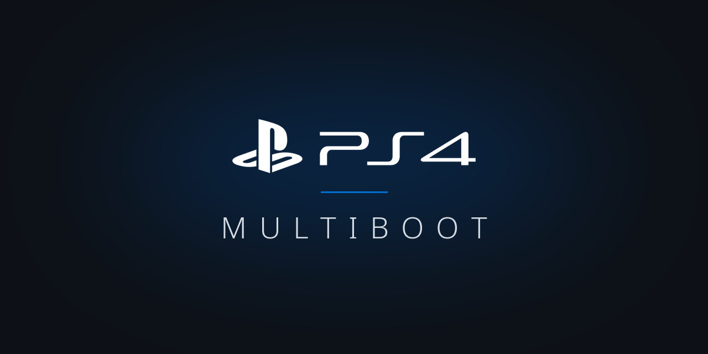
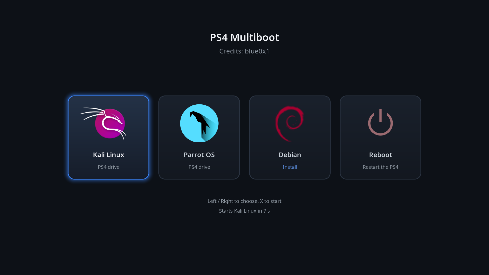

<p align="center">
  
</p>

<h1 align="center">PS4 Multiboot</h1>

<p align="center">
  
  
  <a href="LICENSE"></a>
</p>

One menu to install and boot Linux on a jailbroken PlayStation 4, all from the controller. Use any distro you like: copy its rootfs archive to the PS4 and it appears in the menu, ready to install. The installer adds everything the PS4 needs by itself. No PC tools, partitioning or USB stick are needed.

Created by **[Chokri Hammedi (blue0x1)](https://github.com/blue0x1)**. Based on [Kali Linux for PS4](https://github.com/blue0x1/kali-ps4).

## Features

- **Boot menu on the TV**: one card per distro with its own name and logo. Installed ones start with X, new ones install. The first installed distro starts by itself after 10 seconds.
- **Any distro you choose**: drop in any x86_64 Linux rootfs archive (`.tar.xz`, `.tar.gz` or `.tar.bz2`). The installer adds the PS4 kernel modules and firmware, the HDMI fix, the display settings and a login.
- **3D graphics**: OpenGL 4.5 and Vulkan 1.3 on the PS4 GPU, with the desktop accelerated, from an optional Mesa build for the PS4 (see [3D graphics](#3d-graphics)).
- **Several distros side by side**, each in its own file on the PS4's internal drive (`/user/home/<name>-ps4.img`). The PS4 system software and its other data are not touched, and nothing is repartitioned.
- **Install to the PS4 or to a USB drive**, chosen per distro.
- **Controller support**: a DualShock 4 on a USB cable (left/right to choose, X to confirm, Circle to go back) or a USB keyboard.

## Screenshots



## Requirements

- A jailbroken PS4 with **GoldHEN** (for its FTP server and payload loader).
- A PC on the same network with an FTP client (for example FileZilla).
- About 28 GB free on the PS4 for each distro installed on it (a 16 GB disk, and 10 GB always left free for the PS4), or a USB drive of 8 GB or more per distro.
- Optional: a DualShock 4 with a USB cable, or a USB keyboard.

Consoles: tested on the PS4 Pro (Belize southbridge). Later Slims and Pros with the Baikal southbridge (many CUH-21xx/22xx and CUH-71xx/72xx) are experimental: Linux starts and the display works, but USB drives may not be writable yet. The original PS4 (CUH-10xx/11xx, Aeolia) is not tested yet.

## Install

1. Download from the Releases page: `bzImage`, `initramfs.cpio.gz`, `bootargs.txt` and `linux-2048mb.bin`, and `ps4-mesa.tar.xz` for 3D graphics (optional, recommended).

2. Get the rootfs archive of each distro you want and name it `<name>-ps4-rootfs.tar.xz` (or `.tar.gz`, `.tar.bz2`, keeping its own extension), for example `debian-ps4-rootfs.tar.xz` (see [Choosing a distro](#choosing-a-distro)).

3. Turn on GoldHEN's FTP server and copy the files to the PS4 (port 2121):

   | File | Folder on the PS4 |
   |---|---|
   | `bzImage`, `initramfs.cpio.gz`, `bootargs.txt` | `/data/linux/boot/` |
   | `<name>-ps4-rootfs.tar.xz` / `.tar.gz` / `.tar.bz2` (one per distro) | `/user/home/` |
   | `ps4-mesa.tar.xz` (optional, 3D graphics) | `/user/home/` |
   | `linux-2048mb.bin` | `/data/payloads/` |

4. Run `linux-2048mb.bin` from GoldHEN's payload menu.

   > **Be patient:** after the payload starts, the TV can show **"No signal" or a black screen for 1 to 2 minutes** while Linux starts. This is normal.

5. In the menu, pick a distro, then **Install to PS4** or **Install to USB drive**. A full desktop distro takes about 10 to 15 minutes, a minimal one a few minutes.

## Choosing a distro

You are free to use any distro. The only requirement: its root filesystem for x86_64 (amd64), packed as `.tar.xz`, `.tar.gz` or `.tar.bz2`. ISO files do not work.

Archives come in two kinds:

| Kind | Where to find it | What you get |
|---|---|---|
| **With a desktop** | Distros made for PS4 Linux, for example on [ps4linux.com/downloads](https://ps4linux.com/downloads/) | Boots straight to a desktop |
| **Minimal** | Official rootfs archives, for example on [images.linuxcontainers.org](https://images.linuxcontainers.org/images/) (open `<distro>/<version>/amd64/default/<date>/` and download `rootfs.tar.xz`) | A text login; add a desktop yourself (below) |

PS4 Linux distros built for an older kernel may include their own 3D graphics drivers; their desktop works, but those 3D features may not.

### Adding a desktop to a minimal distro

Plug in a network cable (or join [Wi-Fi](#wi-fi)), log in, and install a desktop. Then restart, and the PS4 boots to a graphical login.

Debian or Ubuntu:

```bash
sudo apt update && sudo apt install xfce4 lightdm
```

Fedora:

```bash
sudo dnf install @xfce-desktop-environment && sudo systemctl set-default graphical.target
```

Arch:

```bash
sudo pacman -Syu xfce4 lightdm lightdm-gtk-greeter && sudo systemctl enable lightdm
```

If `sudo` is missing, run the same command after `su -` (the root password is the same as the user's, see [Logins](#logins)). Light desktops (XFCE, LXQt, MATE) work best, especially without [3D graphics](#3d-graphics).

## What the installer adds

After unpacking an archive, the installer adds what the PS4 needs (all of it is inside `initramfs.cpio.gz`):

- the PS4 kernel modules and extra firmware,
- a service that keeps the PS4 Slim/Pro HDMI output on,
- X display settings for the PS4 GPU,
- 3D graphics, when `ps4-mesa.tar.xz` is in `/user/home/` (see below),
- the hostname `<name>-ps4` and the root filesystem entry in `/etc/fstab`,
- a login when the archive has none: user `<name>`, password `<name>` (root gets the same password).

The distro's name and logo are found automatically: from the archive itself (read in the background while the menu is up), then from the installed system. A distro without a logo file shows the first letter of its name.

## 3D graphics

The standard Mesa graphics driver in distros does not recognize the PS4 GPU, so on its own a distro draws everything in software. `ps4-mesa.tar.xz` from the Releases page is Mesa built with patches for the PS4 GPU (Liverpool on the PS4 and Slim, Gladius on the Pro). With it you get OpenGL 4.5, Vulkan 1.3 and a GPU-accelerated desktop. It installs into `/opt/ps4-mesa` and leaves the distro's own Mesa untouched.

- **New installs:** copy `ps4-mesa.tar.xz` to `/user/home/` once. Every distro installed after that gets it automatically.
- **A distro that is already installed:** copy `ps4-mesa.tar.xz` into it (with `scp`, `wget` or a USB stick), then run this and restart:

  ```bash
  sudo tar -xJf ps4-mesa.tar.xz -C / && sudo /opt/ps4-mesa/bin/ps4-mesa-enable
  ```

- **Check it:** `/opt/ps4-mesa/bin/ps4-mesa-check` (needs `mesa-utils` and `vulkan-tools`) shows the PS4 GPU for OpenGL and Vulkan.
- **Turn it off:** `sudo /opt/ps4-mesa/bin/ps4-mesa-enable --undo`, then restart.

It needs glibc 2.38 or newer, which current distros have (Debian 13, Ubuntu 24.04, Kali, Parrot 7, Fedora 39, Arch and newer). The installer skips it on older distros, which keep software rendering. Tested on a PS4 Pro; the PS4 and PS4 Slim GPU use the same patches.

## Logins

If the archive has its own user, log in with it. If it has none, the installer creates one: user `<name>`, password `<name>` (for `debian-ps4-rootfs.tar.xz`: `debian` / `debian`), and gives root the same password. Change both right away with `passwd` and `sudo passwd root`.

## Wi-Fi

A network cable works without any setup. To join Wi-Fi, open a terminal and run these two commands, with your own network name and password (distros with NetworkManager, which most desktop distros have):

```bash
sudo nmcli con add type wifi con-name home-wifi ifname wlan0 ssid "YOUR_WIFI_NAME" wifi-sec.key-mgmt wpa-psk wifi-sec.psk "YOUR_WIFI_PASSWORD"
sudo nmcli con up home-wifi
```

The PS4 joins it again at every boot. If it does not connect:

- Turn off MAC address randomization, which the PS4 Wi-Fi chip often fails with, then run `sudo nmcli con up home-wifi` again:

  ```bash
  printf '[device]\nwifi.scan-rand-mac-address=no\n\n[connection]\nwifi.cloned-mac-address=preserve\n' | sudo tee /etc/NetworkManager/conf.d/90-ps4-wifi.conf
  sudo systemctl restart NetworkManager
  ```

- Use your router's 2.4 GHz network if it has a separate one, and WPA2 rather than WPA3 only.

## Everyday use

Run the payload. With one distro installed it starts straight away; with more, the menu appears. Shut down or restart from Linux to go back to the PS4 system.

## Add, reinstall or remove a distro

- **Add:** copy its `<name>-ps4-rootfs.tar.xz` (or `.tar.gz`, `.tar.bz2`) to `/user/home/`. It appears in the menu with **Install**.
- **Reinstall:** delete `/user/home/<name>-ps4.img` over FTP.
- **Remove:** delete `/user/home/<name>-ps4.img` and its `<name>-ps4-rootfs` archive.
- **USB install:** reformat the drive on a PC.

## Build from source

You need a Linux PC with Docker, git, make and about 30 GB of free disk space.

```bash
make kernel initramfs        # PS4 kernel and the boot menu with the installer
make mesa                    # 3D graphics: out/ps4-mesa.tar.xz
make ps4-files               # copies the files for the PS4 into ps4-files/
```

Optional: `make rootfs DISTRO=<name>` builds a rootfs archive with a desktop already installed, from a folder in `config/` (Docker base image, default login and package lists). Archives built this way carry their menu name and logo at the start (`etc/ps4-distro/`), so the menu shows them instantly.

Kernel command-line options (in `bootargs.txt`):

| Option | Effect |
|---|---|
| `ps4_default=<name>` | Card selected when the menu opens |
| `ps4_root=LABEL=…` / `UUID=…` / `/dev/…` | Boot this root directly, no menu |
| `ps4_rootwait=30` | Wait longer for a slow USB drive |
| `ps4_rescue` | Open a shell before anything else |

## Project layout

| Path | Contents |
|---|---|
| `initramfs/init` | Boot logic: finds distros, runs the menu, installs and sets up any rootfs for the PS4 |
| `initramfs/fbui.c` | Menu and install screens, controller input, logo conversion, archive scanning |
| `initramfs/blockmap.c` | Maps the image files on the PS4 drive without writing the PS4's file system |
| `initramfs/ps4hdmi.c` | Keeps the PS4 Slim/Pro HDMI output on |
| `initramfs/stb_image.h` | PNG and JPEG decoder for logos ([stb](https://github.com/nothings/stb), public domain / MIT) |
| `patches/kernel/` | HDMI bridge fixes and Baikal southbridge support for the PS4 kernel |
| `patches/mesa/`, `overlay-mesa/` | Mesa patches for the PS4 GPU, and the `ps4-mesa-*` helpers in the 3D graphics bundle |
| `config/`, `docker/`, `scripts/`, `overlay/` | Build system, and settings for the optional `make rootfs` archives |
| `assets/logos/`, `tools/` | Built-in logos, font and logo converters, HDMI bridge debugging tool |

## Credits

PS4 Multiboot builds on the work of others:

- [ps4-linux](https://github.com/sony-jaguar-devs/ps4-linux) (branch `7.0-Clean`): the PS4 Linux kernel. Its release files are built from it with the patches in `patches/kernel/`.
- [rmuxnet's Linux kernel](https://gitlab.com/rmuxnet/linux): Baikal southbridge support; the AHCI polling in `patches/kernel/0003` comes from it.
- [Mesa](https://mesa3d.org/): the optional 3D graphics bundle, with the patches in `patches/mesa/`.
- [GoldHEN](https://github.com/GoldHEN/GoldHEN): the jailbreak, FTP server and payload loader this project relies on.
- [BusyBox](https://busybox.net/), [cryptsetup](https://gitlab.com/cryptsetup/cryptsetup), [e2fsprogs](https://e2fsprogs.sourceforge.net/), [util-linux](https://github.com/util-linux/util-linux) and [XZ Utils](https://tukaani.org/xz/): tools inside the boot image.
- [stb](https://github.com/nothings/stb): the PNG and JPEG decoder for logos.

## License

Copyright (C) 2026 [Chokri Hammedi (blue0x1)](https://github.com/blue0x1).

The project code is GPL-2.0 (see `LICENSE`). `initramfs/stb_image.h` is public domain / MIT. The release files also contain the Linux kernel (GPLv2), BusyBox (GPLv2), XZ Utils and distro packages under their own licenses. Distro names and logos are trademarks of their owners; this project is not affiliated with them.
